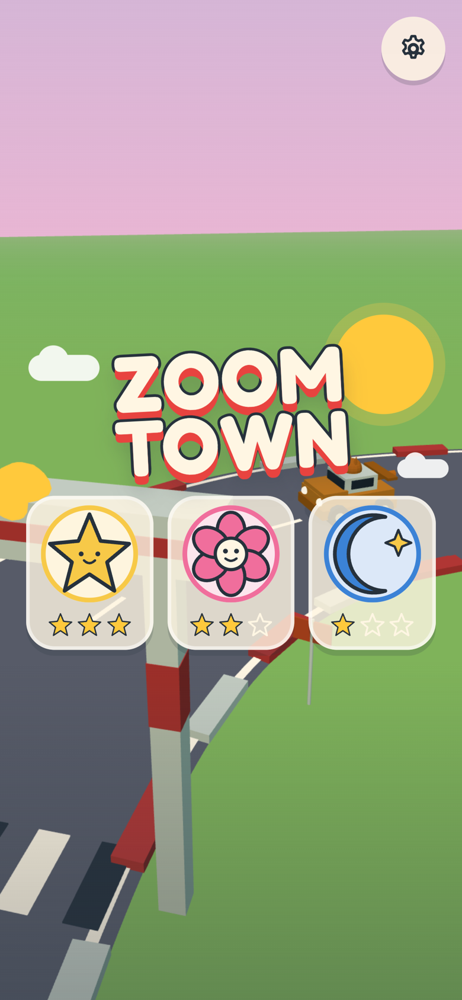
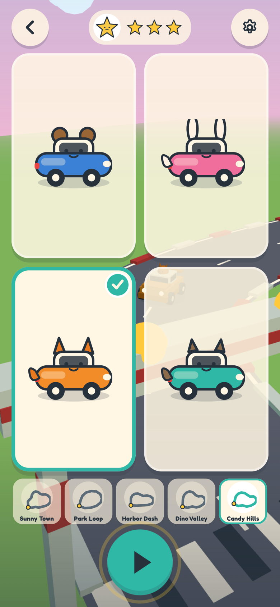
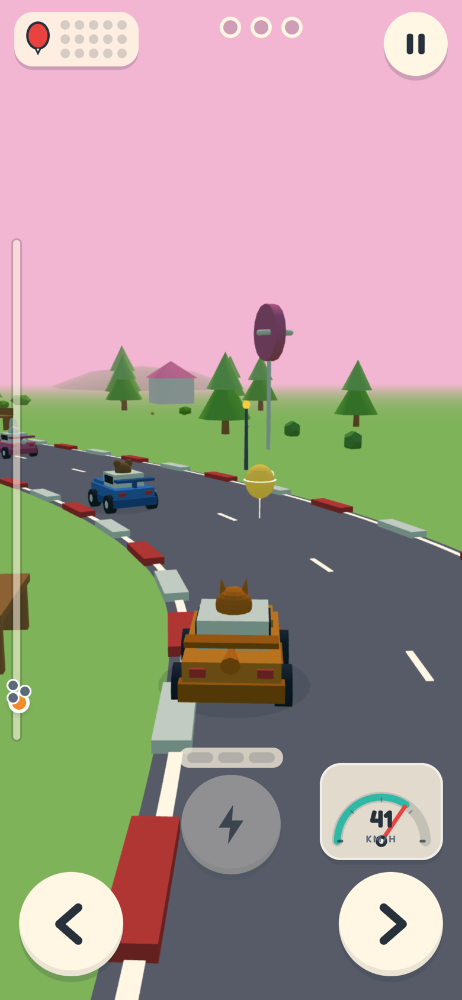
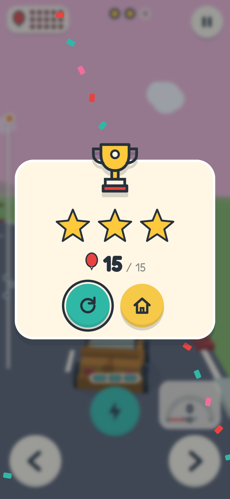

# Zoom Town

A portrait-first 3D toy-town racer for children aged 5–7. The car drives itself, the child steers, pops balloons, and boosts. Five themed circuits, a speedometer, an autopilot after five idle seconds, and four animal drivers. Nobody loses; stars unlock the cars.

**Live:** https://zoom-town.aiu-media.com (also https://zoom-town.alexionutale.workers.dev)

## Screenshots

| Profiles                                                                       | Garage                                                                             |
| ------------------------------------------------------------------------------ | ---------------------------------------------------------------------------------- |
|  |  |

| Racing                                                                                               | Results                                                                        |
| ---------------------------------------------------------------------------------------------------- | ------------------------------------------------------------------------------ |
|  |  |

## Run

```sh
pnpm install
pnpm dev --host 127.0.0.1 --port 4180
```

Open the portrait viewport at `http://127.0.0.1:4180/`. The game is designed for a phone in portrait; desktop shows a centred portrait column.

## Controls

**Touch:** hold the left/right arrows to steer, tap the big button to boost, tap pause to stop.

**Keyboard (desktop):** **← / A** and **→ / D** steer while held, **Space** (or **W** / **↑**) boosts, **P** pauses or resumes, **Esc** pauses. Keys are ignored while a dialog is open, and a muted hint appears in the garage on fine-pointer devices.

If the child stops steering for five seconds, the autopilot drives the car along the road; the first steering input hands control straight back. Advanced driving has no autopilot.

## Commands

```sh
pnpm check        # svelte-check + TypeScript
pnpm build        # static build into build/
pnpm preview      # serve the production build
pnpm test:unit    # Vitest
pnpm test:e2e     # Playwright (portrait flow)
pnpm lint         # Prettier check
pnpm format       # Prettier write
pnpm audio        # regenerate voice/SFX/music with the local studio
pnpm icons        # regenerate PWA icons from the inline SVG
```

`pnpm test:e2e` builds first and drives the production build through Playwright. The
`window.__zoomtown` hook the suite uses only exists when the page is opened with
`?debug=1`, so a normal load exposes no cheat surface. UI copy and accessible names
live in `src/lib/i18n.ts` (IT/EN in parity); `<html lang>` follows the saved language.

## Audio

All audio is generated locally and committed under `static/audio`; the game never uses browser speech synthesis and never fetches audio from a third party at runtime.

- Voices: Qwen3-TTS via `../music-sfx-voice-studio` (`/voice`), Italian and English.
- Music and organic SFX: Stable Audio 3 via the same studio (`/music`, `/sfx/text`).
- Clicks, beeps, rail and bump: the studio's procedural `/sfx` presets.

`pnpm audio --voices`, `--sfx`, `--music`, or `--all --force` regenerates the assets. The studio API must be running at `127.0.0.1:7910`; its token is read from `../music-sfx-voice-studio/data/token`.

## Docs

- [`GLOSSARY.md`](GLOSSARY.md) — the shared language.
- [`ART-STYLE.md`](ART-STYLE.md) — palette, shapes, lighting, motion, HUD.
- [`docs/SPEC.md`](docs/SPEC.md) — screens, rules, track, save schema, acceptance tests.
- [`docs/adr/`](docs/adr/) — stack, portrait-only, no-loss design, code-built art and locally generated audio.
- [`docs/DEVICE-TEST.md`](docs/DEVICE-TEST.md) — the five-minute iPhone pass: install, offline, laps, advanced driving, audio, layout.

## Install on iOS

1. Open the live URL in **Safari**.
2. Tap the **Share** button.
3. Scroll and choose **Add to Home Screen**.
4. Tap **Add**.

The installed app opens full-screen in portrait, keeps its own icon, and works offline after the first load. The game shows these steps on the first iOS visit and keeps them available under Settings → Install app. iOS Safari has no install prompt API, so the instructions are part of the app; Chrome/Firefox on iOS must hand off to Safari first.

## Deploy

`pnpm build` writes a static site to `build/`. Serve it with Cloudflare Workers static assets (Wrangler) or any static host with SPA fallback. The PWA manifest is portrait-only. `src/service-worker.ts` precaches every build chunk, font, and audio file under a per-build cache, serves navigations network-first with an offline fallback, and never caches HTML under a script URL. If the app fails to boot, a recovery card in `src/app.html` offers Reload and Reset instead of a black screen.
